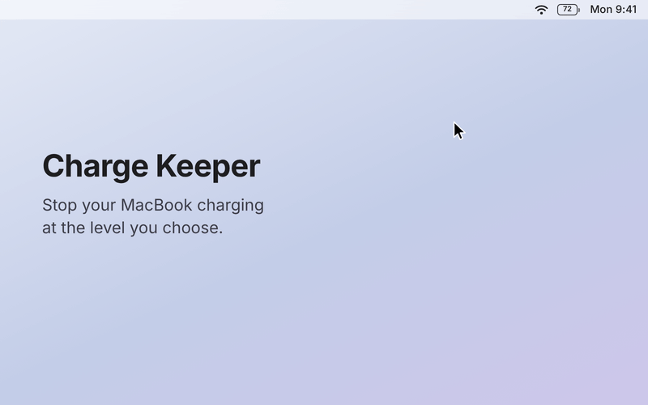
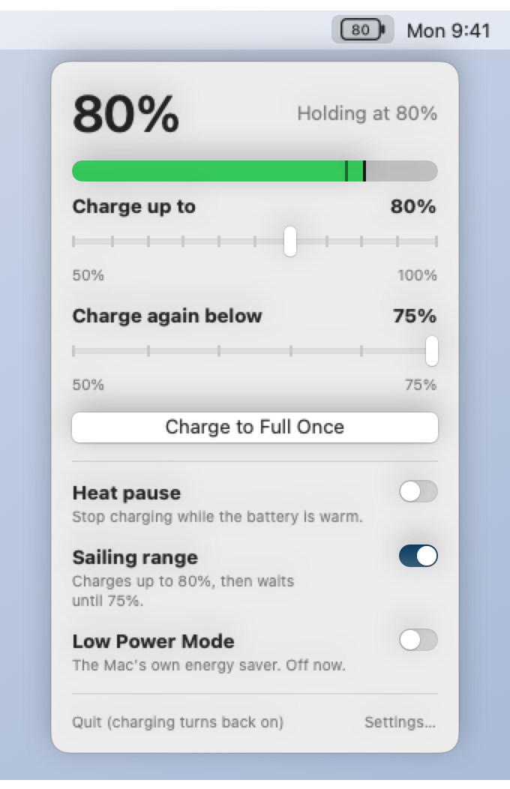
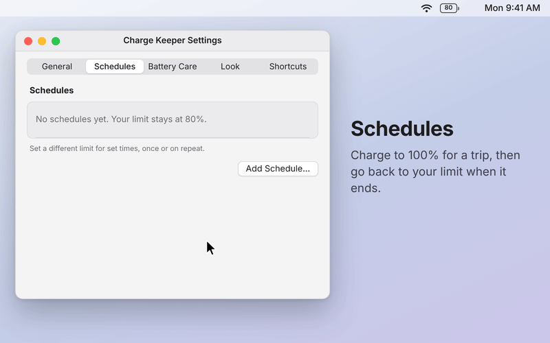
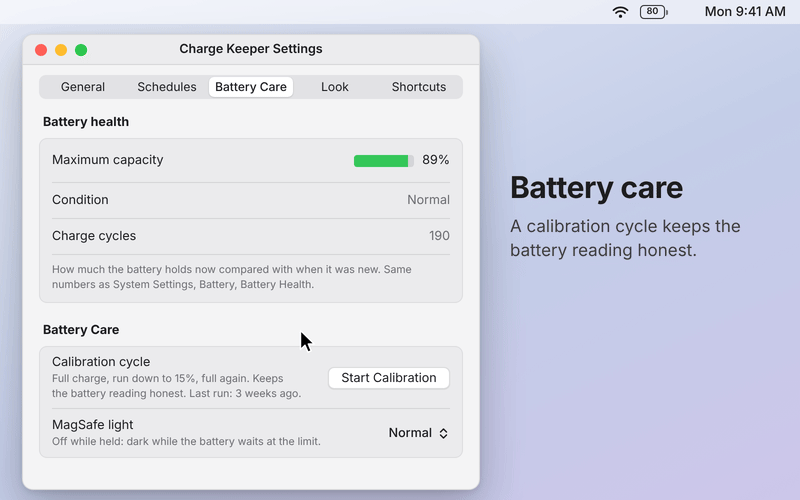
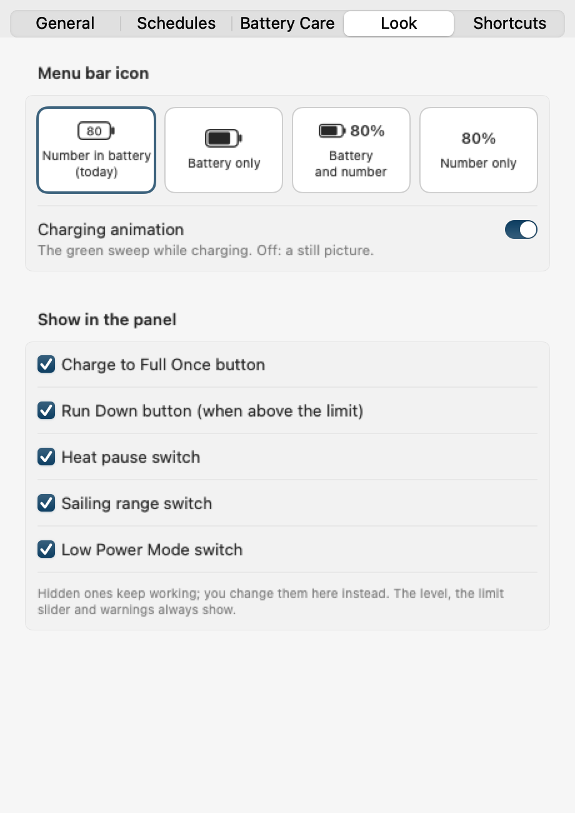

<p align="center">
<picture>
  <source media="(prefers-color-scheme: dark)" srcset="docs/images/hero-dark.gif">
  
</picture>
</p>

<h1 align="center">Charge Keeper</h1>

<p align="center"><b>Stop your MacBook charging at the level you choose.</b><br>A small menu bar app. Free and open source.</p>

<p align="center">
<a href="https://github.com/B0xfan/charge-keeper/releases/latest"></a>

<a href="LICENSE"></a>
</p>

<p align="center"><a href="https://github.com/B0xfan/charge-keeper/releases/latest"><b>Download the latest version</b></a><br>Signed and checked by Apple. Unzip it, then drag it into Applications.</p>

## Why

A laptop battery wears out faster when it sits at 100% all day on the charger. Keeping it lower, around 80%, slows that wear. Charge Keeper holds the battery at your level and lets you go to full whenever you need it.

**Already know AlDente?** Charge Keeper is free, with every feature included and no subscription. It is open source, so anyone can read exactly what it does.

## What it does

<table>
<tr><td width="50%">
<picture>
  <source media="(prefers-color-scheme: dark)" srcset="docs/images/sailing-dark.png">
  
</picture>
</td><td>

### Charge up to any level
Pick a limit from 50% to 100% with one slider in the menu bar. Need the whole battery for a trip? **Charge to Full Once** fills it, then goes back to your limit.

### Sailing range
Lets the battery drift down a little, for example to 75%, before it charges again, so it is not topped up all the time.

### Heat pause
Stops charging while the battery is warm.

</td></tr>
<tr><td>
<picture>
  <source media="(prefers-color-scheme: dark)" srcset="docs/images/schedules-dark.gif">
  
</picture>
</td><td>

### Schedules
Set a different limit for set times, once or on repeat. A Trip schedule can charge to 100% the night before you leave and turn itself off when it ends.

</td></tr>
<tr><td>
<picture>
  <source media="(prefers-color-scheme: dark)" srcset="docs/images/calibration-dark.gif">
  
</picture>
</td><td>

### Battery care
See the battery health macOS reports: maximum capacity, condition and charge cycles. Run a calibration cycle to keep the battery reading honest, and turn the MagSafe light off while the battery waits at the limit.

</td></tr>
<tr><td>
<picture>
  <source media="(prefers-color-scheme: dark)" srcset="docs/images/look-dark.png">
  
</picture>
</td><td>

### Make it yours
Four menu bar icons to choose from, a charging animation you can turn off, and a panel that shows only the switches you use.

</td></tr>
</table>

### Also

- **Run down to your limit.** Above the limit, the Mac runs on battery until it gets there.
- **Low Power Mode** switch right in the panel.
- **Shortcuts actions:** Set Charge Limit, Charge to Full Once, Go Back to My Limit, Run Down to My Limit, Turn Heat Pause On or Off, Turn Sailing Range On or Off, Get Battery Status.
- Starts with your Mac.

## Safe by design

- **Private.** No account, no tracking, and it never goes online.
- Quit the app and charging turns back on. The same happens after a crash, a force quit or a power cut.
- It never changes a limit it did not set, such as Apple's own.
- It steps aside while AlDente runs and while the lid is closed.

## How it works

From 80% to 100% Charge Keeper uses the Mac's own built-in charge limit, with no password. Below 80%, macOS has no limit of its own, so a small helper installed once with your Mac password switches the charger off at the limit and back on a little lower. Without the helper, a limit under 80% holds at 80%.

### Removing the helper

The helper comes out cleanly. Paste this into Terminal and enter your Mac password:

```
"/Applications/Charge Keeper.app/Contents/Resources/install-helper.sh" --remove
```

It switches charging back on first, then deletes the helper and its start-up file. No part of the helper is left on the Mac.

## Requirements

- A MacBook with macOS 14 Sonoma or later.
- Apple silicon. Intel Macs are supported in the code but have not yet been tried on a real Intel Mac.

## For developers

Build, test and signing steps, and the details of how the limit and the helper work, are in [BUILDING.md](BUILDING.md).

## License

GPL-3.0. See [LICENSE](LICENSE). You may use, change and share it; shared versions keep the same license. Made by John Hesch.
